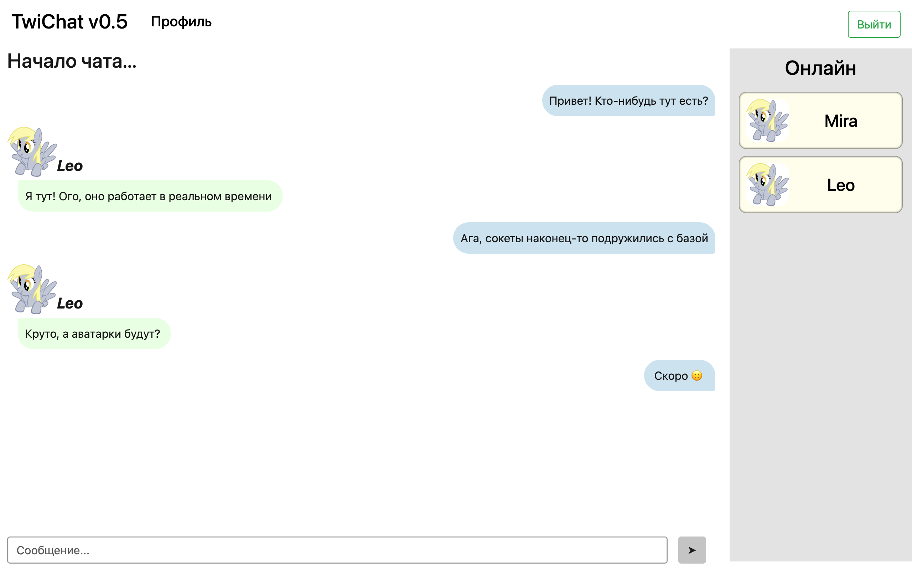

# TwiChat v0.5

Late June 2019. Light and dark styles, user profiles, and avatar uploads stored in MongoDB GridFS.

| Chat | Profile |
| --- | --- |
|  |  |

The theme switch is on the profile page, Princess Celestia for light and Princess Luna for dark. The question above it is a joke I left in back then.

*Screenshots taken in 2026 by running this branch locally on Node 16 and MongoDB 6, with made-up users. The pony avatar is the default one the app gave everyone.*

This branch keeps an early version of TwiChat as it was. The latest version, and the story of how the app grew from here, is on the [`master`](https://github.com/SketchPiece/twi-chat) branch.

Written by hand in 2019, before AI tools. Secrets in the config are placeholders; set your own before running it.
