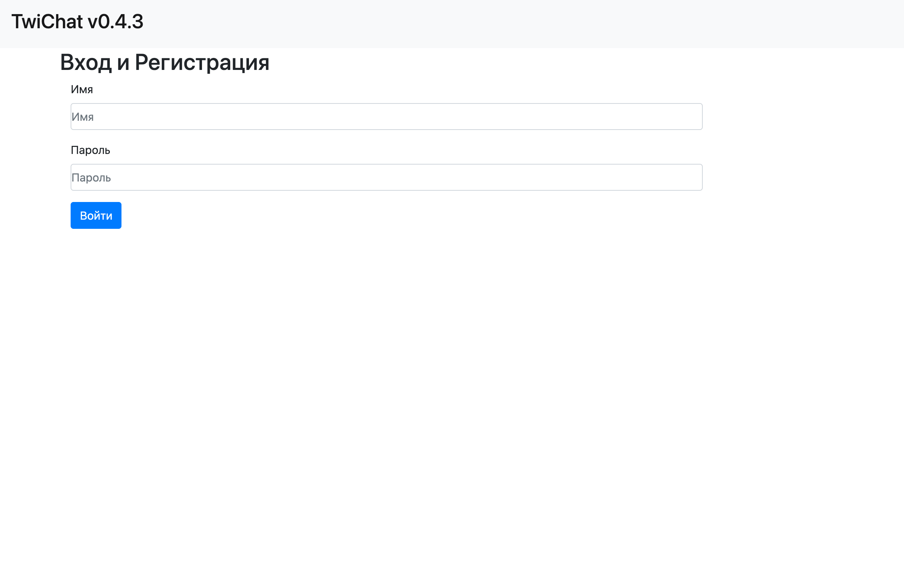

# TwiChat v0.4

June 2019. The first version that worked: Express with EJS templates, sessions stored in MongoDB, and one shared chat room over Socket.io.

| Chat | Login |
| --- | --- |
|  |  |

*Screenshots taken in 2026 by running this branch locally on Node 16 and MongoDB 6, with made-up users. The pony avatar is the default one the app gave everyone.*

This branch keeps an early version of TwiChat as it was. The latest version, and the story of how the app grew from here, is on the [`master`](https://github.com/SketchPiece/twi-chat) branch.

Written by hand in 2019, before AI tools. Secrets in the config are placeholders; set your own before running it.
