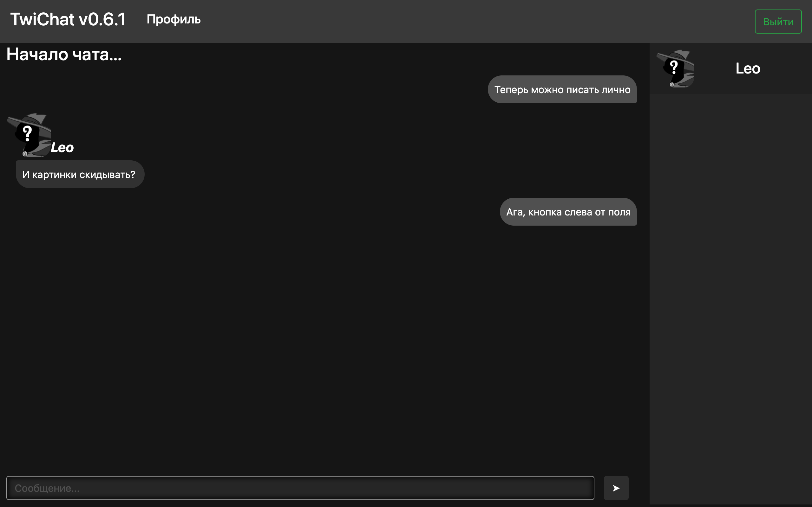
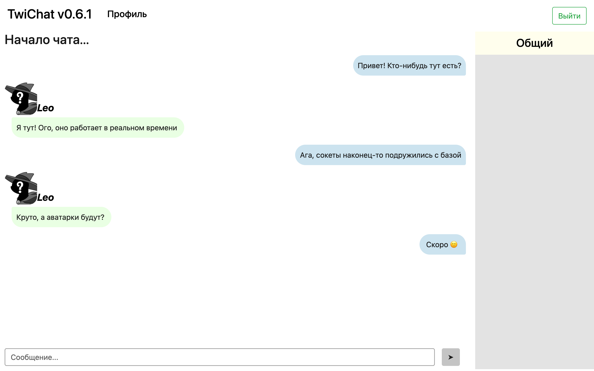
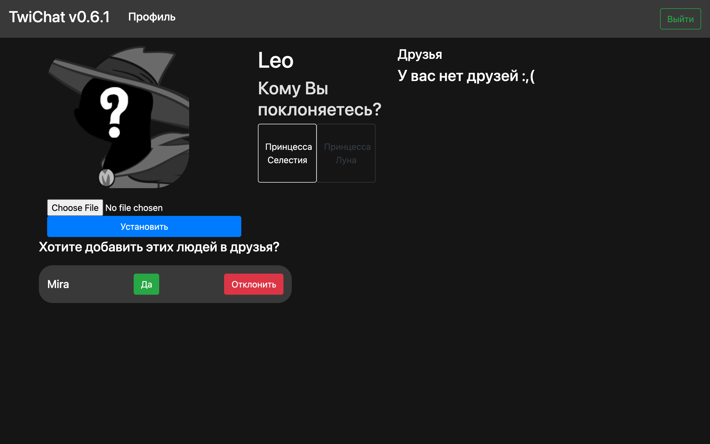
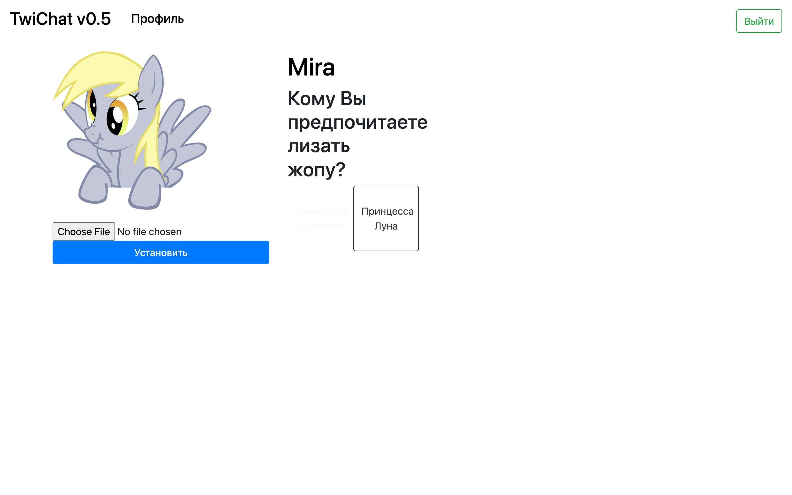

# TwiChat v0.6

July 2019. Still Express and EJS with jQuery and Bootstrap, now with friends, friend requests, direct messages and image uploads (GridFS, with Jimp for resizing).

| Direct messages | Light theme |
| --- | --- |
|  |  |

| Friend request | Profile with friends |
| --- | --- |
|  |  |

The theme switch is the pair of buttons on the profile page, Princess Celestia for light and Princess Luna for dark.

*Screenshots taken in 2026 by running this branch locally on Node 16 and MongoDB 6, with made-up users. The question-mark avatar is the default one.*

This branch keeps an early version of TwiChat as it was. The latest version, and the story of how the app grew from here, is on the [`master`](https://github.com/SketchPiece/twi-chat) branch.

Written by hand in 2019, before AI tools. Secrets in the config are placeholders; set your own before running it.
