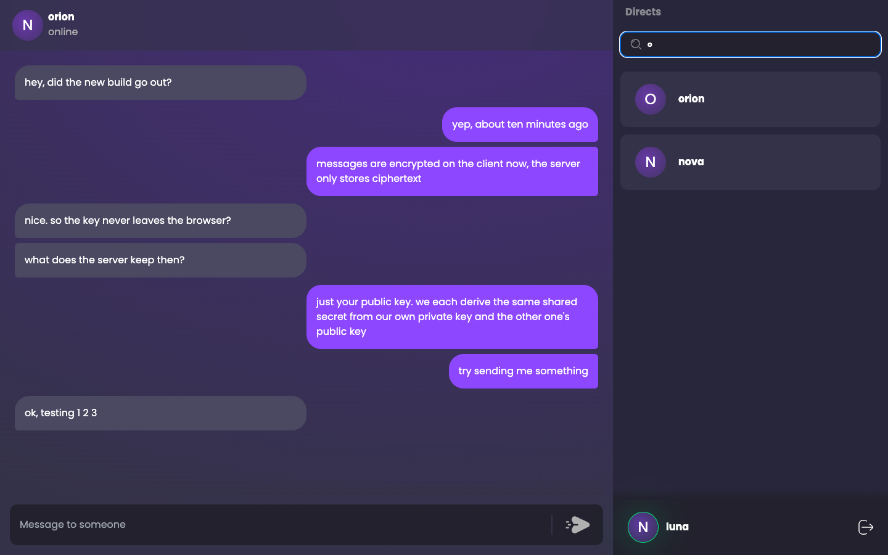
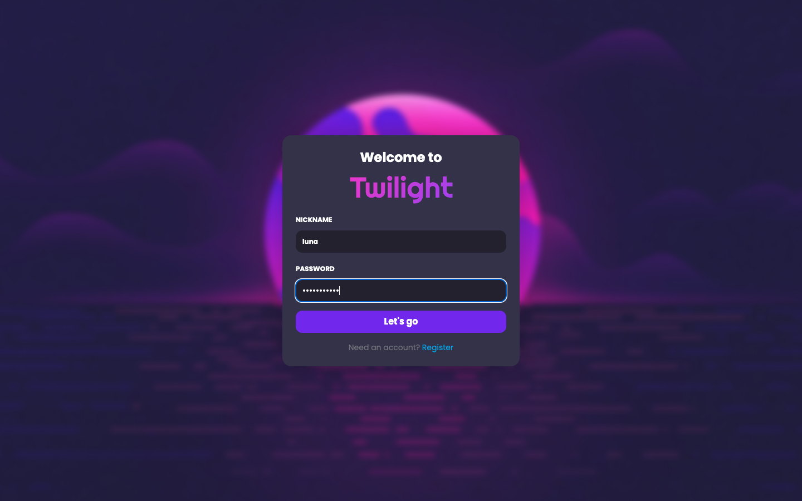

# TwiChat → Twilight

This is the project I became a web developer on. I started TwiChat in 2019, when I had never written a backend or touched a database, and kept rebuilding it as I learned. In 2022 it turned into Twilight, a messenger with end-to-end encryption. Each version is on its own branch, so you can go back in time and see how the code, the stack and I changed.

Everything here was written by hand, before AI coding tools.

| Version | When | What it was | Branch |
| --- | --- | --- | --- |
| TwiChat v0.4 | June 2019 | The first version that worked. Express with EJS templates, sessions in MongoDB, one shared room over Socket.io | [`v0.4`](https://github.com/SketchPiece/twi-chat/tree/v0.4) |
| TwiChat v0.5 | June 2019 | Light and dark styles, profiles, avatar uploads to MongoDB GridFS | [`v0.5`](https://github.com/SketchPiece/twi-chat/tree/v0.5) |
| TwiChat v0.6 | July 2019 | Friends, friend requests, direct messages and image uploads. Still EJS, jQuery and Bootstrap | [`v0.6`](https://github.com/SketchPiece/twi-chat/tree/v0.6) |
| TwiChat v0.8 | 2020–2021 | A full rewrite as a React single-page app with JWT auth and Cloudinary avatars, deployed to Heroku | [`v0.8`](https://github.com/SketchPiece/twi-chat/tree/v0.8) |
| Twilight | 2022–2023 | Started over as an end-to-end encrypted messenger: NestJS, Prisma, Postgres, Socket.io, React, tests and CI | `master`, chat UI on [`twilight-chat-layout`](https://github.com/SketchPiece/twi-chat/tree/twilight-chat-layout) |

| TwiChat v0.8 (2020) | Twilight (2022) |
| --- | --- |
|  |  |

The rest of this page is about Twilight. The story of the TwiChat versions is in the README on the [`v0.8`](https://github.com/SketchPiece/twi-chat/tree/v0.8) branch.

## Twilight

Twilight is a messenger with end-to-end encryption that I built between July 2022 and June 2023. It has a NestJS backend with a REST API and Socket.io, and a React client. The idea: the client derives the keys and encrypts messages itself, so the server only ever sees public keys and ciphertext.

It is one of the projects I learned the most from: auth with refresh tokens, WebSockets, writing API docs, testing against a real database, and some applied cryptography.



*The screenshots come from the `twilight-chat-layout` branch, run locally with made-up users. The message list in the chat screen is still hardcoded in that branch. User search uses the real API.*

### What works

- Registering and logging in with a nickname and password. The API issues short-lived access tokens and long-lived refresh tokens (JWT). Refresh tokens are rotated on every refresh, and only their bcrypt hashes are stored.
- User search by nickname, with pagination.
- Uploading the user's public key.
- Direct conversations ("directs") between two users, with a last-message preview and an unread counter on each side.
- Sending messages in real time over Socket.io. The socket connection is authenticated with the same access token, and each user joins a room named after their user ID.
- Swagger docs for the REST API and AsyncAPI docs for the socket events.
- The client-side encryption, as a separate service with unit tests (see below).

What is not finished: the client UI was never connected to the encryption service or the socket, so the pieces work on their own but not yet end to end in the browser. The mobile layout of the chat is also incomplete. In mid-2023 I started a rewrite on the T3 stack (Next.js, tRPC, Prisma, NextAuth). It never got past the scaffold, so it is not included here.

### How the encryption works

All of this is client code, in [`client/src/services/encryption.service.ts`](client/src/services/encryption.service.ts):

1. **Private key.** The client feeds the seed `userId/password` into a seeded CSPRNG ([ISAAC](client/src/utils/randomBytesSeed)) and takes 256 bytes from it. That is the user's private key. Because it is deterministic, the same key can be recreated on any device from the password, and it never has to be stored or sent anywhere.
2. **Public key.** The private key is used as a Diffie-Hellman exponent over the standard 2048-bit MODP group (`modp14`, RFC 3526). The resulting public key goes to the server (`POST /api/users/public-key`) and is stored on the user record.
3. **Shared secret.** To talk to someone, the client takes its own private key and the other user's public key and computes the DH shared secret. Both sides arrive at the same value, and the secret itself never goes over the network.
4. **Messages.** Text is encrypted and decrypted with [`cryptr`](https://github.com/MauriceButler/cryptr), using the shared secret as the key. Under the hood that is AES-256-GCM, with a key derived through PBKDF2 and a random salt and IV for each message.

The server stores and forwards message text as it gets it, so once the client encrypts first, the database only ever holds ciphertext.

Looking back at it now, the trade-offs are clear. Because the key comes from the password, a weak password means a weak key, and changing the password changes the key. There is no forward secrecy, since every message in a conversation uses the same static secret. Nothing lets users verify each other's public keys either, so you have to trust the server to hand out the right one. For a learning project I was happy with it, but it is not Signal.

### Architecture

```
client/  React + Vite + Tailwind  ──REST /api/*──►  NestJS (src/)  ──Prisma──►  PostgreSQL
                                  ◄──Socket.io────►
```

Backend (`src/`):

- `auth/`: register, login, logout and refresh. Passport JWT strategies for access and refresh tokens, and a global access-token guard with a `@Public()` opt-out.
- `users/`: paginated user search and public key updates.
- `messages/`: the directs REST controller and the `message` / `clearUnseen` socket handlers.
- `connection/`: the socket gateway that puts each connected user in their own room. `adapters/AuthIoAdapter.ts` checks the JWT during the socket handshake.
- `prisma/`: schema and migrations for `User`, `Direct` and `Message`. Each conversation is stored as two `Direct` rows, one per participant, that share a hash.

Client (`client/`): React 18, Redux Toolkit for auth state, React Hook Form + Yup for forms, axios, Tailwind.

### Stack

NestJS 8, Prisma 4, PostgreSQL 12, Socket.io 4, Passport/JWT, bcrypt, Swagger (`@nestjs/swagger`), AsyncAPI (`nestjs-asyncapi`), React 18, Vite 2, Tailwind 3, Redux Toolkit, Jest, Supertest, Cypress, Docker Compose for the databases, GitHub Actions for CI.

### Running it locally

You need Node.js (16 was current back then; the backend also runs on newer versions) and Docker.

```bash
# databases: dev on :5432, tests on :5435
docker compose up -d

# backend
cp .env.example .env
npm install
npx prisma migrate deploy
npm run start:dev          # http://localhost:4000

# client (in another terminal)
cd client
npm install
npm run dev                # http://localhost:3000, proxies /api to :4000
```

The running backend also serves the API docs:

- Swagger: http://localhost:4000/api
- AsyncAPI (socket events): http://localhost:4000/async-api

`master` has the login and registration screens. The chat screen is on the [`twilight-chat-layout`](https://github.com/SketchPiece/twi-chat/tree/twilight-chat-layout) branch.

### Tests

```bash
# backend: e2e tests for the REST controllers and the socket gateway,
# against a real Postgres (restarts the compose stack and resets the test DB first)
npm test

# client: unit tests for the encryption service
cd client && npm test

# client: Cypress tests for the login and register forms (needs the client running)
cd client && npm run test:e2e
```

CI (`.github/workflows/production.yml`) runs all three on every push and pull request.

### Credits

I built the backend, the encryption and the auth flow. [Alexander Serhiienko](https://github.com/AlexanderSerhiienko) built most of the client layout, the chat UI and the Cypress tests, and reviewed and merged the pull requests.
