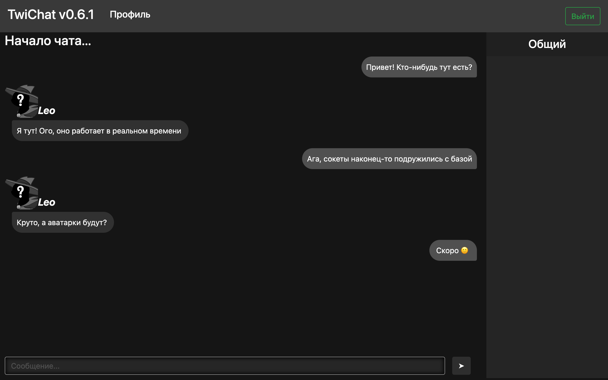
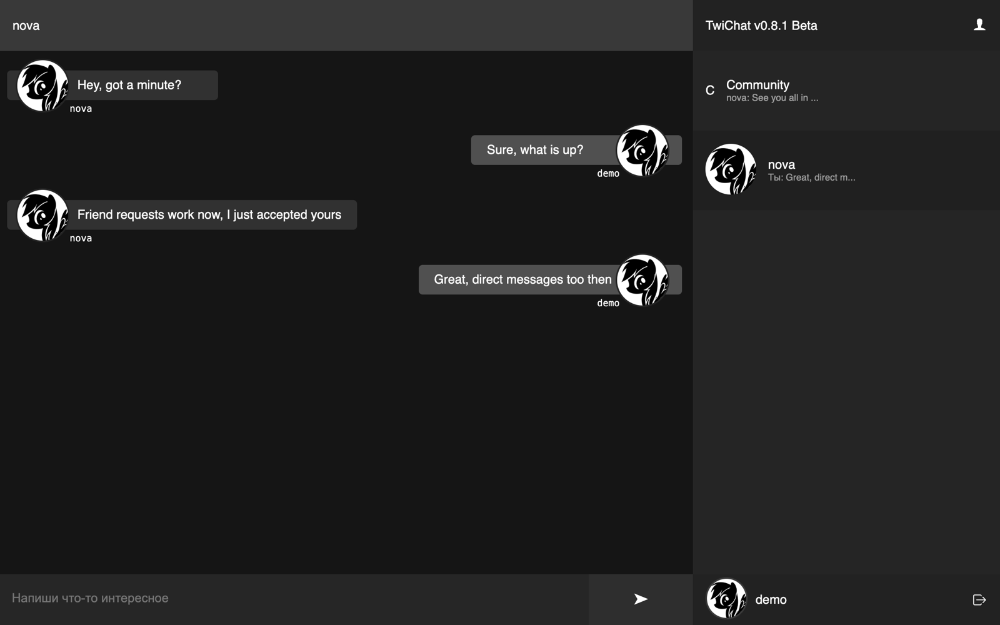
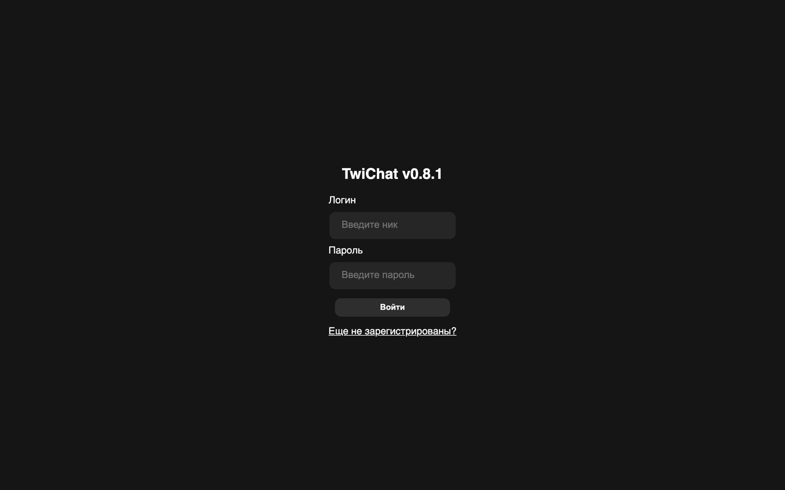

# TwiChat → Twilight

This is the chat app I learned web development on. I started it in 2019 at sixteen, having never built a website before, and kept rebuilding it over the next three years. Each version is on its own branch if you want to see how the code changed over time.

Everything here was written by hand, before AI coding tools.

| TwiChat v0.8 (2020) | Twilight (2022) |
| --- | --- |
|  |  |

## The story

### A dare on a pony server

In 2019 I spent a lot of time on a Discord server for fans of My Little Pony. One of the people there, MasterTime, was making his own game, and one day he said, "You're a programmer, let's make a social network." I knew some Python and a bit of C#, had never built a website, and still said yes. I figured if I could pull off a social network, I could build anything.

So I googled "how to make websites", watched screencasts, and patched things together from tutorials. The first working version came together in one evening in June 2019. I called it TwiChat, after Twilight Sparkle.

The hardest part was WebSockets: getting messages between browsers in real time while tying them to logins and the database broke something at every step. I wanted to ask on Stack Overflow plenty of times, but I was too shy, so I just kept digging until I found someone who had hit the same issue.

Over the next month I added themes, profiles, avatars, friends, direct messages and pictures. People from the server dropped in to try it, and mostly it was fun showing each new feature to MasterTime and seeing his reaction.

| v0.4, June 2019 | v0.6, July 2019 |
| --- | --- |
|  |  |

### Why I switched to React

Right after the first version went up, a guy from the server sent a chat message with a script inside it. I didn't sanitize anything, so the script ran for everyone who opened the chat. I had no idea that was even possible. The next day [v0.4.3](https://github.com/SketchPiece/twi-chat/commit/5acb2d9) came out with two lines that replaced `<` and `>` in every message. When I read later that React escapes text by default, I realized I was probably missing plenty of other things like that.

At first I didn't get why anyone needed a framework when plain JS could do everything, until I started using React and saw how much simpler it made the stuff I'd been wrestling with in jQuery.

### The React version

In February 2020 I rewrote TwiChat from scratch in React. It took ten days to get to the "TwiChat v0.8 Beta" release. I worked through the nights and fell asleep wanting to wake up and finish whatever I was in the middle of. My school friend Sasha ([Alexander Serhiienko](https://github.com/AlexanderSerhiienko)), who was learning to program with me, moved the colors into themes and made the light one.

| Direct messages | Light theme | Login |
| --- | --- | --- |
|  |  |  |

After the release I spent a couple of weeks fixing bugs, the worst of them in the sockets. But the server never really moved to TwiChat, and it turned into my own playground for trying new things. Later that year I started a TypeScript version and dropped it, because I got my first job as a developer.

### Coming back as Twilight

In the summer of 2022, right after leaving my second job, I wanted to rebuild TwiChat properly with everything I'd learned at work. This time it would be a messenger, closer to Telegram than to a social network, with end-to-end encryption so the server could never read the messages. I called it Twilight. It sounded better than TwiChat and felt more like a real brand.

By then Sasha was working as a developer too, and we tried to run it like a real team. We planned tasks in Trello, he did the frontend, I did the backend, and we reviewed each other's pull requests. In three weeks we had sign-up with refresh tokens, user search, direct chats over Socket.io, API docs, tests, CI and an encryption service on the client.

After that we burned out. A few months later I co-founded a small studio and moved to Canada, so Twilight stopped right before we wired the frontend up to the sockets and encryption. It sat online for a while, unfinished, and nobody used it. In 2023 I started one more rewrite on the T3 stack and never got past the setup.


### Looking back

Neither TwiChat nor Twilight turned into something people actually used. Every time I learned something new, I threw out the old version and started over instead of finishing what I had.

Even so, most of what I learned about web dev started as a bug or a feature in this repo: sockets, auth, databases, React, and later reviewing PRs with someone else. My only real regret is being too shy to ask questions back then; it would have saved me a lot of late nights.

MasterTime, if you ever read this, thank you. That dare is how I became a programmer. ❤️

## Versions

| Version | When | What it was | Branch |
| --- | --- | --- | --- |
| TwiChat v0.4 | June 2019 | The first version that worked. Express with EJS templates, sessions in MongoDB, one shared room over Socket.io | [`v0.4`](https://github.com/SketchPiece/twi-chat/tree/v0.4) |
| TwiChat v0.5 | June 2019 | Light and dark styles, profiles, avatar uploads to MongoDB GridFS | [`v0.5`](https://github.com/SketchPiece/twi-chat/tree/v0.5) |
| TwiChat v0.6 | July 2019 | Friends, friend requests, direct messages and image uploads. Still EJS, jQuery and Bootstrap | [`v0.6`](https://github.com/SketchPiece/twi-chat/tree/v0.6) |
| TwiChat v0.8 | 2020–2021 | A full rewrite as a React single-page app with JWT auth and Cloudinary avatars, deployed to Heroku | [`v0.8`](https://github.com/SketchPiece/twi-chat/tree/v0.8) |
| Twilight | July 2022 | Started over as an end-to-end encrypted messenger. NestJS, Prisma, Postgres, Socket.io, React, tests and CI | `master`, chat UI on [`twilight-chat-layout`](https://github.com/SketchPiece/twi-chat/tree/twilight-chat-layout) |

More about the TwiChat versions and how to run v0.8 is in the README on the [`v0.8`](https://github.com/SketchPiece/twi-chat/tree/v0.8) branch.

## How Twilight works

Twilight has a NestJS backend with a REST API and Socket.io, and a React client. The client derives the keys and encrypts messages itself, so the server only ever sees public keys and ciphertext.

*The screenshots come from the `twilight-chat-layout` branch, run locally with made-up users. The message list in the chat screen is still hardcoded in that branch. User search uses the real API.*

### What works

- Registering and logging in with a nickname and password. The API issues short-lived access tokens and long-lived refresh tokens (JWT). Refresh tokens are rotated on every refresh, and only their bcrypt hashes are stored.
- User search by nickname, with pagination.
- Uploading the user's public key.
- Direct conversations ("directs") between two users, with a last-message preview and an unread counter on each side.
- Sending messages in real time over Socket.io. The socket connection is authenticated with the same access token, and each user joins a room named after their user ID.
- Swagger docs for the REST API and AsyncAPI docs for the socket events.
- The client-side encryption, as a separate service with unit tests (see below).

What is not finished: the client UI was never connected to the encryption service or the socket, so the pieces work on their own but not yet end to end in the browser. The mobile layout of the chat is also incomplete.

### How the encryption works

All of this is client code, in [`client/src/services/encryption.service.ts`](client/src/services/encryption.service.ts):

1. **Private key.** The client feeds the seed `userId/password` into a seeded CSPRNG ([ISAAC](client/src/utils/randomBytesSeed)) and takes 256 bytes from it. That is the user's private key. Because it is deterministic, the same key can be recreated on any device from the password, and it never has to be stored or sent anywhere.
2. **Public key.** The private key is used as a Diffie-Hellman exponent over the standard 2048-bit MODP group (`modp14`, RFC 3526). The resulting public key goes to the server (`POST /api/users/public-key`) and is stored on the user record.
3. **Shared secret.** To talk to someone, the client takes its own private key and the other user's public key and computes the DH shared secret. Both sides arrive at the same value, and the secret itself never goes over the network.
4. **Messages.** Text is encrypted and decrypted with [`cryptr`](https://github.com/MauriceButler/cryptr), using the shared secret as the key. Under the hood that is AES-256-GCM, with a key derived through PBKDF2 and a random salt and IV for each message.

The server stores and forwards message text as it gets it, so once the client encrypts first, the database only ever holds ciphertext.

This design has obvious flaws: a weak password means a weak key, changing the password changes the key, there's no forward secrecy (every message in a chat reuses the same secret), and there's no way to verify public keys, so you still have to trust the server. It was great for learning how Diffie-Hellman fits into a real app, just not something you'd ship for real security.

### Architecture

```
client/  React + Vite + Tailwind  ──REST /api/*──►  NestJS (src/)  ──Prisma──►  PostgreSQL
                                  ◄──Socket.io────►
```

Backend (`src/`):

- `auth/`: register, login, logout and refresh. Passport JWT strategies for access and refresh tokens, and a global access-token guard with a `@Public()` opt-out.
- `users/`: paginated user search and public key updates.
- `messages/`: the directs REST controller and the `message` / `clearUnseen` socket handlers.
- `connection/`: the socket gateway that puts each connected user in their own room. `adapters/AuthIoAdapter.ts` checks the JWT during the socket handshake.
- `prisma/`: schema and migrations for `User`, `Direct` and `Message`. Each conversation is stored as two `Direct` rows, one per participant, that share a hash.

Client (`client/`): React 18, Redux Toolkit for auth state, React Hook Form + Yup for forms, axios, Tailwind.

### Stack

NestJS 8, Prisma 4, PostgreSQL 12, Socket.io 4, Passport/JWT, bcrypt, Swagger (`@nestjs/swagger`), AsyncAPI (`nestjs-asyncapi`), React 18, Vite 2, Tailwind 3, Redux Toolkit, Jest, Supertest, Cypress, Docker Compose for the databases, GitHub Actions for CI.

### Running it locally

You need Node.js (16 was current back then; the backend also runs on newer versions) and Docker.

```bash
# databases: dev on :5432, tests on :5435
docker compose up -d

# backend
cp .env.example .env
npm install
npx prisma migrate deploy
npm run start:dev          # http://localhost:4000

# client (in another terminal)
cd client
npm install
npm run dev                # http://localhost:3000, proxies /api to :4000
```

The running backend also serves the API docs:

- Swagger: http://localhost:4000/api
- AsyncAPI (socket events): http://localhost:4000/async-api

`master` has the login and registration screens. The chat screen is on the [`twilight-chat-layout`](https://github.com/SketchPiece/twi-chat/tree/twilight-chat-layout) branch.

### Tests

```bash
# backend: e2e tests for the REST controllers and the socket gateway,
# against a real Postgres (restarts the compose stack and resets the test DB first)
npm test

# client: unit tests for the encryption service
cd client && npm test

# client: Cypress tests for the login and register forms (needs the client running)
cd client && npm run test:e2e
```

CI (`.github/workflows/production.yml`) runs all three on every push and pull request.

### Credits

I built the backend, the encryption and the auth flow. [Alexander Serhiienko](https://github.com/AlexanderSerhiienko) built most of the client layout, the chat UI and the Cypress tests. We reviewed each other's pull requests.
