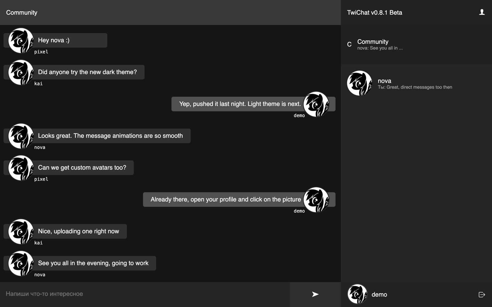
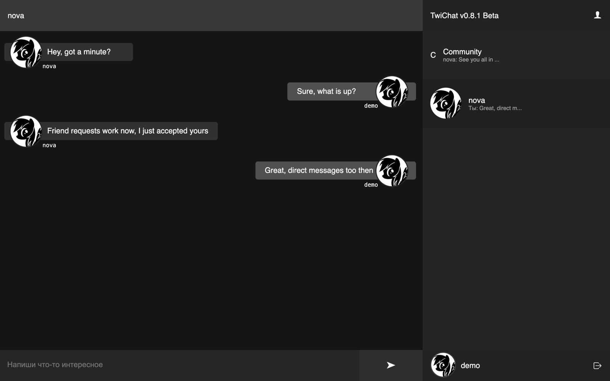
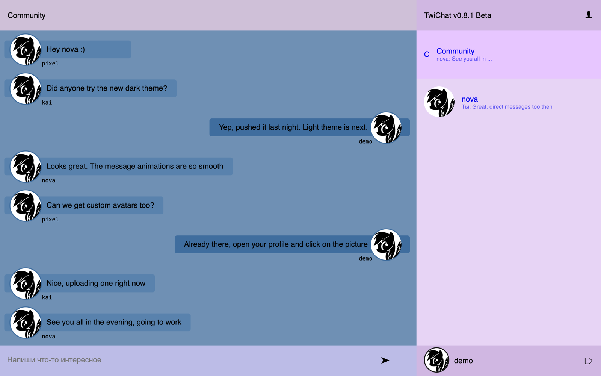
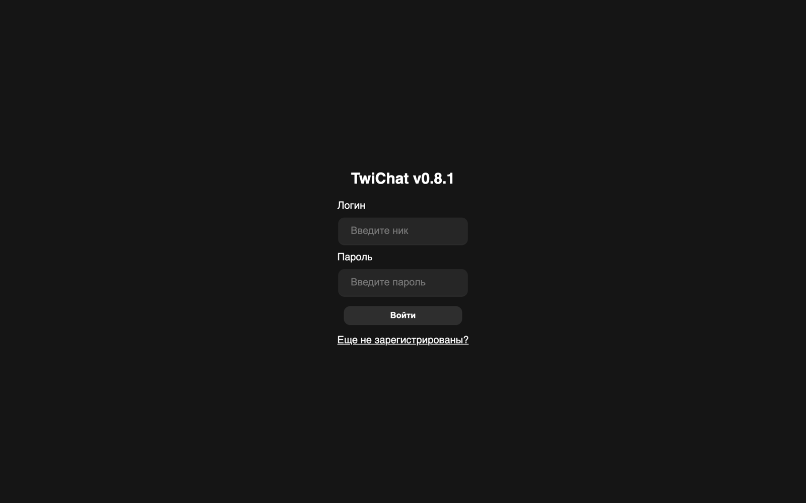

# TwiChat

TwiChat is a real-time chat app I built between 2019 and 2021. It is the project I learned web development on. When I started it I had never written a backend or used a database, and most of what I know about Node.js, React, WebSockets and auth started here.

It is not a polished product. It is a record of learning: the code changes style from one commit to the next, the commit messages are mostly in Russian, and you can watch bugs get fixed one by one. This repository has the whole history, and each early version lives on its own branch: [`v0.4`](https://github.com/SketchPiece/twi-chat/tree/v0.4), [`v0.5`](https://github.com/SketchPiece/twi-chat/tree/v0.5) and [`v0.6`](https://github.com/SketchPiece/twi-chat/tree/v0.6). `master` is the latest one.

This is a pre-AI project. Everything here was written by hand, with documentation, Stack Overflow and a lot of trial and error.



## The story, in versions

**v0.4 (June 2019), branch [`v0.4`](https://github.com/SketchPiece/twi-chat/tree/v0.4).** The first version that worked. Express with EJS templates, sessions stored in MongoDB, and one shared chat room over Socket.io. A run of commits called "version 0.4 socket db edit" is me figuring out how sockets and the database fit together.

**v0.5 (late June 2019), branch [`v0.5`](https://github.com/SketchPiece/twi-chat/tree/v0.5).** Light and dark styles, user profiles, and avatar uploads stored in MongoDB GridFS.

**v0.6 (July 2019), branch [`v0.6`](https://github.com/SketchPiece/twi-chat/tree/v0.6).** Still Express and EJS with jQuery and Bootstrap, now with friends, friend requests, direct messages and image uploads (GridFS, with Jimp for resizing).

**v0.8 (February 2020 to 2021), `master`.** A full rewrite as a single-page app: React on the client, Express and Socket.io on the server, JWT instead of sessions, and Cloudinary for avatars. Released as "TwiChat v0.8 Beta" in February 2020 and deployed to Heroku. After that came bug fixes and, later, moving the database to a new host.

I also started a TypeScript rewrite (v0.9) in September 2020 but never got past the skeleton, so it is not included.

## Features (v0.8)

- Sign up and log in; passwords hashed with bcrypt, sessions as 30-day JWTs
- A shared "Community" room with messages delivered in real time over Socket.io
- Direct messages between users, with the latest message shown in the sidebar
- "Someone is typing" indicators
- Older messages load as you scroll up
- Friends and friend requests
- Profiles with a status line and an avatar (uploaded to Cloudinary)
- User badges (`Dev`, verified)
- Dark theme, plus a light theme stylesheet
- Animated message bubbles and a layout that works on phones
- A Konami-code easter egg for users with the `Dev` badge

The interface is in Russian, as it was built for friends.

| Direct messages | Light theme | Login |
| --- | --- | --- |
|  |  |  |

The final version ships with the dark theme turned on. The light screenshot uses `client/public/themes/Light.css`, which is in the repo but has no switch in the UI. All names and messages in the screenshots are made-up demo data.

## Stack

- **Server:** Node.js, Express, Socket.io 2, Mongoose 5 (MongoDB), jsonwebtoken, bcryptjs, express-validator, node-config
- **Client:** React 16 (Create React App), React Router 5, socket.io-client, axios, react-animated-css
- **Storage:** MongoDB for users, chats and messages; Cloudinary for avatars
- **Hosting at the time:** Heroku with mLab, later MongoDB Atlas

The early versions use Express, EJS, jQuery, Bootstrap 4, express-session with connect-mongo, and GridFS.

## Running it locally

These dependencies are from 2020, so use **Node.js 16**. The old `config` package does not work on Node 23 and newer, and `react-scripts` 3 does not build on Node 17 and newer without extra flags. You also need a MongoDB server; I tested with MongoDB 6.0.

```bash
git clone https://github.com/SketchPiece/twi-chat.git
cd twi-chat
npm install
npm run client:install
```

Settings live in `config/default.json` and can be overridden with environment variables (see `.env.example` and `config/custom-environment-variables.json`):

| Variable | Default | What it is |
| --- | --- | --- |
| `PORT` | `5000` | Server port |
| `MONGO_URI` | `mongodb://localhost:27017/twichat` | MongoDB connection string |
| `JWT_SECRET` | `CHANGE_ME` | Secret for signing tokens; set your own |
| `CLOUDINARY_CLOUD_NAME`, `CLOUDINARY_API_KEY`, `CLOUDINARY_API_SECRET` | empty | Optional, used to delete old avatars |

For avatar uploads, copy `client/.env.example` to `client/.env` and fill in your Cloudinary cloud name and an unsigned upload preset. Without them everything else works and every user gets the default avatar.

Development mode, with the API on port 5000 and the React dev server on port 3000:

```bash
JWT_SECRET=something-random npm run dev
```

Production mode, where Express serves the built client:

```bash
npm run client:build
JWT_SECRET=something-random npm start
```

Then open the app, register a couple of users in different browser windows and start chatting.

## Credits

Written by me, [SketchPiece](https://github.com/SketchPiece). [Alexander Serhiienko](https://github.com/AlexanderSerhiienko) worked with me on the v0.8 client in February 2020: he moved the colors out of the main stylesheet into separate dark and light themes and built the light theme for the chat.

Before this repository was made public, the history was cleaned up: old database URLs, the JWT secret and Cloudinary keys were replaced with placeholders, links to real people's avatars and a few rude joke strings were swapped out, and the config was moved to environment variables. Otherwise the code is as it was.
